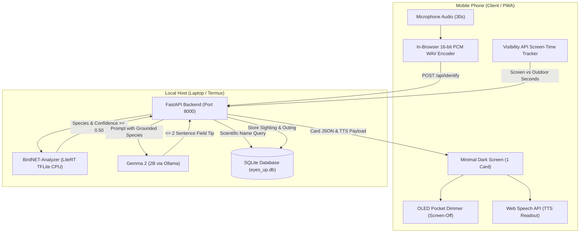

# Architecture: Eyes Up

Eyes Up is designed around a single architectural constraint: **the user should spend less than 10 seconds looking at their screen for every 30 minutes spent in nature.**

Everything runs 100% locally on-device without cloud dependencies, user accounts, or external network requests.

---

## System Flow Diagram

---

## Core Component Breakdown

### 1. Client-Side PCM WAV Encoder (`app/static/app.js`)
Mobile browsers record audio through the `MediaStream` and `AudioContext` APIs. Instead of transmitting browser-specific WebM/Opus or AAC containers (which would require server-side `ffmpeg` binaries and complex decoding), client JavaScript samples the raw Float32 audio stream and packages it into standard 16-bit PCM WAV in memory. This eliminates backend codec dependencies.

### 2. Bioacoustic Classification Engine (`app/birdnet_service.py`)
Powered by the Cornell Lab of Ornithology's BirdNET V2.4 model (~61 MB FP32 TFLite). Audio is analyzed in 3-second sliding segments. Detections are grouped by scientific species name, taking peak confidence across the recording. Results below the configurable threshold (default `0.50`) are discarded to prevent noisy guesses.

### 3. Grounded Local Intelligence (`app/llm_service.py`)
Gemma 2 (2B) runs locally via Ollama (`http://localhost:11434`). It performs three bounded tasks:
- **Species Identification Tip**: Formulates a 1–2 sentence visual or behavioral cue (under 40 words) grounded strictly in verified field marks. If uncertain, it replies "Unsure".
- **Daily Outing Nudge**: Analyzes the user's logged life list and the current calendar month to recommend a 15-minute outing habitat and target species.
- **Field Journal Entry**: Summarizes outdoor outing duration and observed species.

### 4. Persistence & Touch Grass Scoring (`app/db.py`)
A single SQLite database stores sightings and outings. The **Touch Grass Score** calculates the ratio of outdoor minutes logged against screen-active minutes monitored via `document.visibilityState`. If the screen was active for 2 minutes over a 40-minute hike, the score reports `20.0x (95% eyes up)`.

### 5. Multi-Adapter Audio Readout (`app/tts_service.py`)
Allows the user to identify birds with their phone in their pocket:
- **Default (Zero Install)**: Client-side `window.speechSynthesis` using native OS voices.
- **Local CLI**: Optional `piper` or `espeak-ng` adapter.
- **Cloud Adapter**: Optional ElevenLabs REST adapter (swappable, disabled by default).
